<div align="center">

# Hello there. 🌌⚔️ I'm Kacper 👋

### AI Engineer · Computer Vision & 3D Perception

<a href="https://kacperpawlowski.tech">
  
</a>

</div>

I build computer vision and 3D perception systems end to end: the data pipeline, the model, an
honest evaluation against an independent reference, and deployment on the hardware it has to run
on. AI engineer at Lighthouse Consulting (visual inspection and predictive maintenance) and MSc
student at NTNU in Trondheim (Computer Science with AI, and Industrial Mathematics).

```json
{
  "role": "AI Engineer",
  "focus": ["computer vision", "3D perception", "edge AI"],
  "now": "AI engineer @ Lighthouse Consulting",
  "education": "MSc @ NTNU, AI & Industrial Mathematics",
  "website": "kacperpawlowski.tech"
}
```

---

## 🔭 Projects

Every project starts from raw data and ends with a number I can defend. Where a project
reimplements a published method, its README compares my results with the paper's.

> **Not everything is here.** Much of my professional work is covered by NDAs, and some projects
> are still being built or have not been published yet. The repositories below are my own work,
> open source and reproducible, and new ones are added as they are finished.

### Computer Vision · Detection & Tracking

| Project                                                                                | What it does                                                                                                                                                                                       | Demo                                                                                                                                          |
| -------------------------------------------------------------------------------------- | -------------------------------------------------------------------------------------------------------------------------------------------------------------------------------------------------- | --------------------------------------------------------------------------------------------------------------------------------------------- |
| **[vaktsom](https://github.com/kapi0okapi/vaktsom)**                                   | Detects drowning in public swimming pools and alerts the lifeguards. An RF-DETR detector trained on Blender renders from ceiling cameras, 3D tracking of every bather through the water surface from several cameras, and ISO 20380 alarm rules: all **200** simulated ISO tests passed, with no false alarms. | 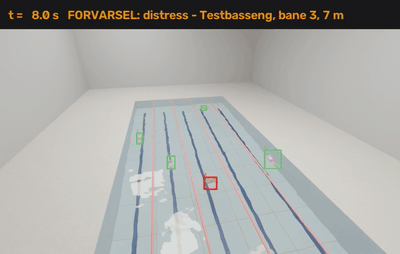 |
| **[vehicle-counter](https://github.com/kapi0okapi/vehicle-counter)**                   | Counts vehicles in traffic video. Detects cars and trucks with YOLO26, follows each one from frame to frame with tracking algorithms such as ByteTrack and BoT-SORT, and counts it once when it crosses a line: **2.7 %** counting error on traffic cameras it never saw. | 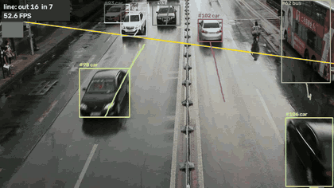                                                      |
| **[hand-gesture-recognition](https://github.com/kapi0okapi/hand-gesture-recognition)** | Recognises hand gestures from a camera. Compares small neural networks on hand keypoints from MediaPipe with a YOLO26 detector that looks at the whole image (**99.3 %** of gestures right).       | 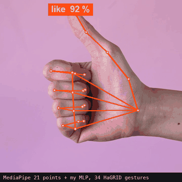 |

### Computer Vision · Segmentation

| Project                                                                              | What it does                                                                                                                                                                                                         | Demo                                                                                                               |
| ------------------------------------------------------------------------------------ | -------------------------------------------------------------------------------------------------------------------------------------------------------------------------------------------------------------------- | ------------------------------------------------------------------------------------------------------------------ |
| **[road-scene-segmentation](https://github.com/kapi0okapi/road-scene-segmentation)** | Labels every pixel of a road scene: road, cars, signs and guard rails. Compares seven segmentation models, including YOLO26, SegFormer and Mask2Former, and teaches one of them to find guard rails.                 |                 |
| **[clock-reader](https://github.com/kapi0okapi/clock-reader)**                       | Reads the time from a photo of an analogue clock. A U-Net in PyTorch, trained only on generated images, finds the hands, and geometry turns them into a time. **98.6 %** of tilted clocks are read within 5 minutes. | 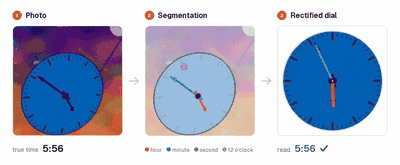 |

### Vision-Language · Search & RAG

| Project | What it does | Demo |
| --- | --- | --- |
| **[multimodal-image-search](https://github.com/kapi0okapi/multimodal-image-search)** | Finds photos from a sentence or from another photo, and answers questions about a photo collection with citations to the photos it used. SigLIP 2 and Perception Encoder embeddings are fused in one FAISS index and reranked by the Qwen3-VL vision-language model: the right photo comes first in **89.7 %** of Flickr30k searches, ahead of every single published model it is compared with. |  |

### Depth, 3D Perception & SLAM

| Project                                                                              | What it does                                                                                                                                                                                                                                                              | Demo                                                                                                                             |
| ------------------------------------------------------------------------------------ | ------------------------------------------------------------------------------------------------------------------------------------------------------------------------------------------------------------------------------------------------------------------------- | -------------------------------------------------------------------------------------------------------------------------------- |
| **[monocular-depth](https://github.com/kapi0okapi/monocular-depth)**                 | Estimates distance from a single camera image. Compares eleven depth models, including Depth Anything and Depth Pro, on the KITTI driving dataset, and fine-tunes a real-time YOLO26 model that measures distance in metres more accurately than the large metric models. | 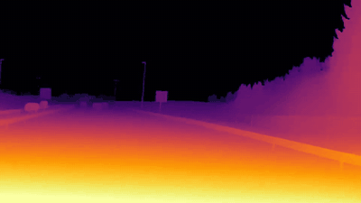                                                     |
| **[lidar-slam](https://github.com/kapi0okapi/lidar-slam)**                           | Tracks a car's position and builds a map from LiDAR scans (SLAM). My own implementation of KISS-ICP with loop closure drifts **0.63 %** over all of the KITTI dataset.                                                                                                    | 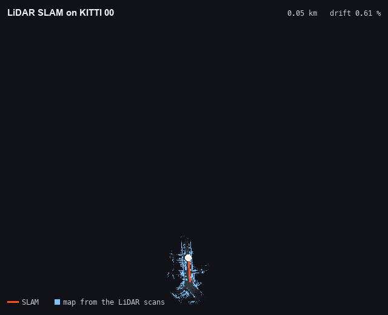       |
| **[lidar-road-segmentation](https://github.com/kapi0okapi/lidar-road-segmentation)** | Classifies 3D LiDAR points along a road, such as road, cars and guard rails, with a RandLA-Net network in PyTorch (**81.8** mIoU, same as the paper), then measures guard-rail height from the result.                                                                    | 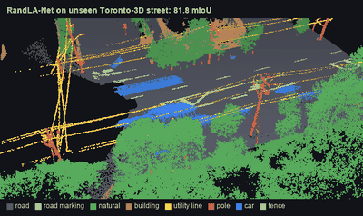 |
| **[gnss-ins-fusion](https://github.com/kapi0okapi/gnss-ins-fusion)**                 | Combines GPS and motion-sensor (IMU) data with a Kalman filter for a smooth, accurate position, even when GPS drops out in tunnels. Tested on real KITTI drives.                                                                                                          | 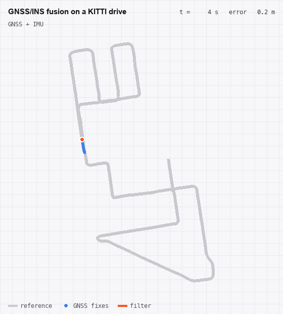                        |

### Visual Inspection

| Project                                                                                | What it does                                                                                                                                                                                                             | Demo                                                                                                                                |
| -------------------------------------------------------------------------------------- | ------------------------------------------------------------------------------------------------------------------------------------------------------------------------------------------------------------------------ | ----------------------------------------------------------------------------------------------------------------------------------- |
| **[visual-anomaly-detection](https://github.com/kapi0okapi/visual-anomaly-detection)** | Finds defects in product images after learning only from good ones. PatchCore and PaDiM built in PyTorch, close to the published results on the VisA benchmark (AUROC **0.914**).                                        | 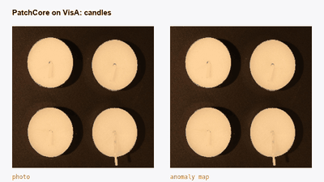          |
| **[guardrail-inspector](https://github.com/kapi0okapi/guardrail-inspector)**           | Checks road photos against Norway's road database. Trains image classifiers in PyTorch on 30,000 photos labelled automatically from map data (**0.98** AP for guard rails), and maps where photos and database disagree. | 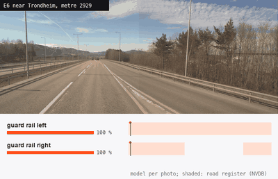 |
| **[inspection-platform](https://github.com/kapi0okapi/inspection-platform)**           | A web platform that compares AI results with Norway's road database, built with PostgreSQL/PostGIS, FastAPI, an interactive map, Docker and Terraform for AWS. The guard-rail model reaches **91 %** precision.          | 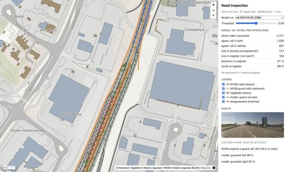                         |

### Drones

| Project                                                                            | What it does                                                                                                                                                                                                 | Demo                                                                                                              |
| ---------------------------------------------------------------------------------- | ------------------------------------------------------------------------------------------------------------------------------------------------------------------------------------------------------------ | ----------------------------------------------------------------------------------------------------------------- |
| **[drone-object-detection](https://github.com/kapi0okapi/drone-object-detection)** | Finds people and vehicles in drone photos, where most objects are tiny. Trains YOLO26 on image tiles instead of shrunk photos, which nearly doubles the accuracy on small objects (**26.5** AP on VisDrone). | 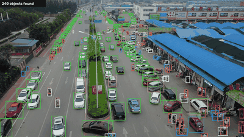               |
| **[drone-landing-zones](https://github.com/kapi0okapi/drone-landing-zones)**       | Decides where a drone can land safely. A YOLO26 segmentation model labels the ground below, and a rule in metres picks the nearest clear spot away from people: **94 %** safe decisions on unseen photos.    | 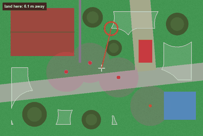 |

### Edge AI & Deployment

| Project                                                                  | What it does                                                                                                                                                                                                                                 | Demo                                                                                                                       |
| ------------------------------------------------------------------------ | -------------------------------------------------------------------------------------------------------------------------------------------------------------------------------------------------------------------------------------------- | -------------------------------------------------------------------------------------------------------------------------- |
| **[edge-optimization](https://github.com/kapi0okapi/edge-optimization)** | Makes a YOLO26 detector three times smaller for edge devices with INT8 quantization (ONNX Runtime, OpenVINO, Core ML, TensorRT). Keeps **97 %** of the accuracy, ahead of quantization-aware training, and runs up to 2x faster on x86 CPUs. | 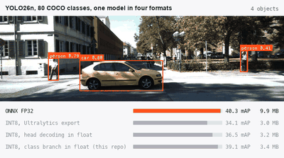 |

### Face Analysis

| Project                                                            | What it does                                                                                                                                                                                                            | Demo                                                                                                                           |
| ------------------------------------------------------------------ | ----------------------------------------------------------------------------------------------------------------------------------------------------------------------------------------------------------------------- | ------------------------------------------------------------------------------------------------------------------------------ |
| **[age-estimation](https://github.com/kapi0okapi/age-estimation)** | Estimates a person's age from a face photo with a ConvNeXt network, after aligning the face with MediaPipe, and reports the error separately for age groups, genders and ethnicities. Off by **4.25** years on average. | 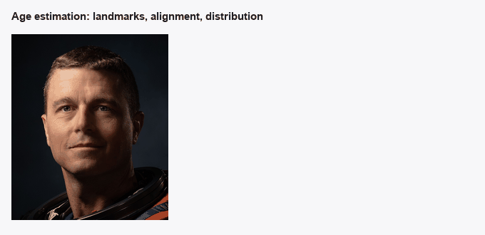 |

More on **[kacperpawlowski.tech](https://kacperpawlowski.tech)**: project write-ups, technical articles
(English, Norwegian, Polish) and a lab where four of these models run in your browser.

---

## 🛠️ Tech Stack

The AI and computer vision stack first, then everything else I build with.

### 🧠 AI, Deep Learning & Computer Vision

<p align="left">
  
  
  
  
  
  
  
  
  
  
  
  
  
  
</p>

### 📐 3D Perception, LiDAR & Sensor Fusion

<p align="left">
  
  
  
  
  
</p>

### ⚡ Model Deployment & MLOps

<p align="left">
  
  
  
  
  
  
  
  
</p>

### 🗺️ Geospatial Data

<p align="left">
  
  
  
</p>

### 💻 Languages

<p align="left">
  
  
  
  
  
  
  
  
  
  
  
</p>

### 🎨 Frontend & Design

<p align="left">
  
  
  
  
  
</p>

### ⚙️ Backend & APIs

<p align="left">
  
  
  
  
  
  
</p>

### 🗄️ Databases & ORMs

<p align="left">
  
  
  
  
  
</p>

### ☁️ Cloud, DevOps & Hosting

<p align="left">
  
  
  
  
  
  
  
  
</p>

### 📱 Mobile & Game Dev

<p align="left">
  
  
  
</p>

---

## 📫 Let's connect

<div align="center">
  <a href="https://kacperpawlowski.tech">
    
  </a>
  <a href="mailto:contact@kacperpawlowski.tech">
    
  </a>
  <a href="https://www.linkedin.com/in/kacper-pawlowski-914ab8297/">
    
  </a>
</div>
